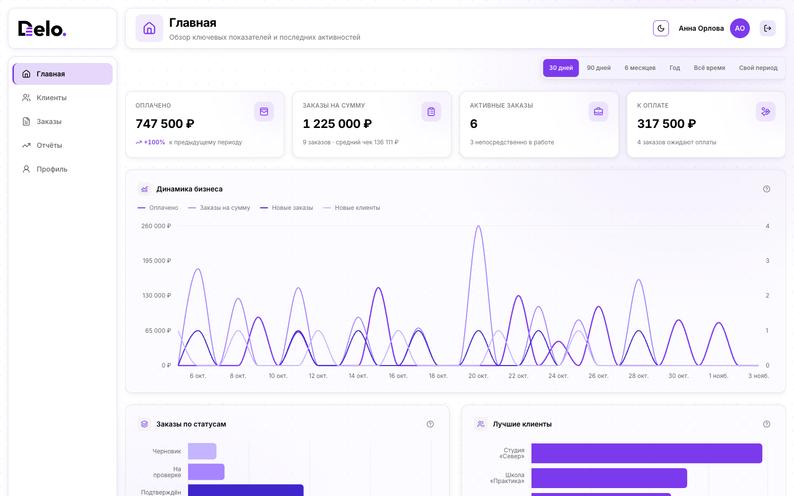
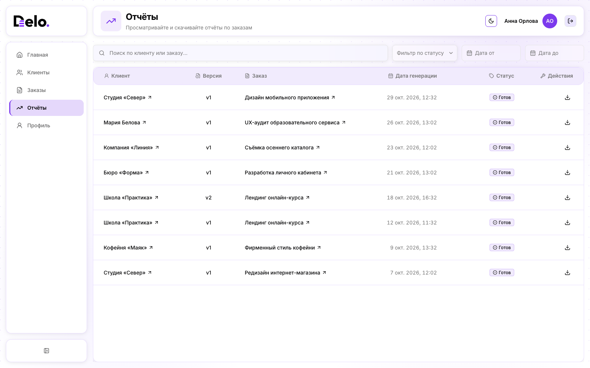

# Delo

<p align="center">
  
</p>

**Delo** помогает самозанятым и фрилансерам вести работу с клиентами в одном месте: фиксировать условия заказов, получать подтверждение по ссылке, учитывать оплаты и видеть общую картину на дашборде. Подтверждённые условия сохраняются в версионных PDF-отчётах.

[Посмотреть интерфейс](#интерфейс) · [Возможности](#возможности) · [Как проходит заказ](#как-проходит-заказ) · [Локальный запуск](#локальный-запуск)

## Интерфейс

**Дашборд.** Ключевые показатели, динамика бизнеса, статусы заказов, лучшие клиенты и ближайшие сроки собраны на одном экране. Период можно менять от 30 дней до всей истории работы.



**Отчёты.** После подтверждения условий Delo сохраняет PDF-отчёт. Список показывает клиента, заказ, номер версии, дату генерации и состояние файла.



**Для клиента.** Публичная страница показывает условия, состав работ, статус и оплату. Клиент может подтвердить заказ по ссылке без регистрации.


**Для исполнителя.** В карточке заказа видны клиент, сроки, платежи и прикреплённые PDF. Скриншоты показывают демонстрационные данные.


## Возможности

- клиенты и заказы с поиском, фильтрами и историей действий;
- публичное подтверждение условий без регистрации клиента;
- пример клиентского заказа без регистрации на `/order/demo`, только с вымышленными данными;
- ручной учёт частичных и полных оплат;
- дашборд с финансовыми и операционными показателями за выбранный период;
- версионные PDF-отчёты по подтверждённым условиям;
- договоры, счета и акты в PDF рядом с заказом;
- подтверждение почты, восстановление пароля и адаптивный интерфейс.

## Как проходит заказ

1. **Создайте клиента и заказ.** Укажите работы, цену, даты и условия.
2. **Поделитесь ссылкой.** Клиент откроет публичную страницу и подтвердит заказ без учётной записи.
3. **Ведите исполнение.** Меняйте статус, отмечайте частичные и полные оплаты, прикрепляйте PDF; события сохраняются в истории.
4. **Следите за результатом.** Дашборд обновляет показатели, а отчёты сохраняют версии подтверждённых условий.

Списки клиентов, заказов и отчётов поддерживают поиск, фильтрацию и постепенную подгрузку. Для входа в сервис есть подтверждение почты и восстановление пароля.

При регистрации отдельно принимаются условия использования и [согласие на обработку
персональных данных](src/app/consent/page.tsx). Оба чекбокса по умолчанию выключены и
проверяются общей Zod-схемой на клиенте и сервере. Политика обработки данных — отдельный
информационный документ, а разрешение аналитики не входит в регистрационное согласие.
Дата принятия каждого документа и его версия сохраняются в существующих полях
пользователя; старые записи автоматически не обновляются. Страница `/consent` доступна
без входа, исключена из sitemap и аналитических путей и остаётся `noindex`.

Оператор: Баранов Максим Владимирович, физическое лицо. Контакт для поддержки и обращений
по персональным данным: `delodoc.support@proton.me`. Замена контакта не меняет отправителя
автоматических писем Resend; работоспособность входящих проверяется отдельно владельцем
ящика.

На лендинге кнопка «Посмотреть пример заказа» открывает демонстрационную страницу. Она не загружает реальные заказы, не сохраняет данные и не позволяет подтвердить условия. В настоящем заказе согласование вынесено в отдельный блок.

## Локальный запуск

Нужны Node.js с npm, доступный **PostgreSQL** и Docker. Docker Compose в этом репозитории запускает Mailpit и MinIO, но не базу данных.

```bash
npm install
cp .env.example .env.local
openssl rand -base64 32
```

В `.env.local` укажите адрес базы в `DATABASE_URL` и сохраните результат `openssl` в `AUTH_SECRET`. Остальные значения из примера подходят для локального Mailpit и MinIO.

```bash
npm run docker:up
npx prisma migrate dev
npm run dev
```

Откройте [приложение](http://localhost:3000). Письма доступны в [Mailpit](http://localhost:8025), файлы — в [консоли MinIO](http://localhost:9001).

## Индексация и публикация

Production: `APP_ENV=prod`, `NEXT_PUBLIC_APP_URL=https://www.delo-doc.ru`.
QA: `APP_ENV=dev`, `NEXT_PUBLIC_APP_URL=https://qa.delo-doc.ru`.

Основной домен — `www.delo-doc.ru`; Vercel перенаправляет на него `delo-doc.ru`.
В Vercel значение `NEXT_PUBLIC_APP_URL` для Production должно совпадать с основным
origin и задаваться до новой сборки. Изменение переменной не обновляет уже
опубликованный deployment — требуется новый production-деплой с актуальным кодом.
Локальный адрес `http://localhost:3000` и QA-адрес менять не нужно.

Метрика и Vercel Speed Insights загружаются только в production на `www.delo-doc.ru`
после разрешения необязательной аналитики в cookie-плашке. Выбор можно изменить
через «Настройки cookies» в футере. Метрика считает просмотры известных публичных
страниц, авторизации и кабинета, а также четыре цели: переход к регистрации,
успешная регистрация, добавление заказчика и создание заказа.
ID в адресах заменяются на `:id`, пользовательские заголовки и фрагменты URL не
передаются, страницы заказов по токену исключены. Из query Метрика получает только
стандартные `utm_source`, `utm_medium`, `utm_campaign`, `utm_content`, `utm_term`
с любыми значениями, только на публичных информационных страницах и после согласия.
Полный набор не обязателен, при повторении ключа берётся первое значение. Не включайте
в метки контакты, токены и другие личные данные: значения передаются как заданы в ссылке.
Остальные параметры и все query в Speed Insights удаляются. Прямой заход не подменяется ссылкой с самого
сайта. Speed Insights
работает только на главной и юридических страницах. Расширение аналитики требует
нового opt-in (версия ключа согласия обновлена).
Vercel Web Analytics не используется.

Cookie-баннер предлагает «Только необходимые» и «Разрешить аналитику»; отказ не
скрывается и не мешает работе сервиса. Версия согласия — `v4`, прежний выбор `v2`/`v3`
не включает расширенную аналитику автоматически. Метки до разрешения не отправляются
и не сохраняются приложением в браузерное хранилище. Готовые ссылки на десять
зарезервированных размещений и таблица результатов — в [учёте пилота](docs/pilot-tracking.md).
Это заготовка: реальные площадки ещё не выбраны, результаты не заполнены.

Resend может вернуть ошибку в поле `error`, не выбрасывая исключение. `sendEmail()`
проверяет этот результат. Созданный аккаунт сохраняется при сбое письма подтверждения,
а интерфейс предлагает повторную отправку из профиля вместо ложного сообщения об
успехе. Принятие письма почтовым сервисом не доказывает доставку во входящие.

Индексация включается только для production-конфигурации. Непроизводственные
хосты дополнительно получают `X-Robots-Tag: noindex, nofollow`.
Reverse proxy должен передавать исходный `Host`, чтобы production-домен
корректно отличался от QA и preview-хостов.

После публикации добавьте `https://www.delo-doc.ru/sitemap.xml` в Google Search Console
и Яндекс Вебмастер и запросите обход главной страницы. Для подтверждения через
meta-теги задайте `GOOGLE_SITE_VERIFICATION` и `YANDEX_SITE_VERIFICATION`
(значение `content`, без HTML). Canonical всегда указывает на `www.delo-doc.ru`.
QA и служебные страницы не включаются в sitemap; роботам разрешён обход,
чтобы они могли увидеть `noindex`. SEO-превью находится в `public/og-image.png`.

## API Метрики

Для локальной работы с целями, настройками и отчётами используется `node scripts/metrica.mjs`. Скрипт остаётся локальным, исключён из Git и отсутствует в свежем клоне репозитория. Он обращается напрямую к официальному API, без MCP-сервера и без включения токена в приложение. Новые зависимости не нужны.

### Подключение

1. [Создайте OAuth-приложение Яндекса](https://oauth.yandex.ru/?dialog=create-client-entry), выберите «Для доступа к API или отладки» и разрешения `metrika:read` и `metrika:write`. Этот доступ распространяется на доступные аккаунту счётчики, а не только на Delo.
2. Скопируйте публичный ClientID и получите ссылку авторизации:

   ```bash
   node scripts/metrica.mjs auth-url --client-id <ClientID>
   ```

3. Откройте ссылку самостоятельно и разрешите доступ. Полученный OAuth-токен не присылайте в чат, не передавайте аргументом команды и не сохраняйте в Git.
4. Сохраните только токен одной строкой в `~/.config/opencode/secrets/yandex-metrica-token`. Пустой файл подготовлен локально с правами `600`; каталог — `700`. Это обычный защищённый правами файл, как ключ Context7, а не зашифрованное хранилище. Для другого компьютера создайте каталог и пустой файл с теми же правами. Открыть файл в редакторе macOS:

   ```bash
   open -e ~/.config/opencode/secrets/yandex-metrica-token
   ```

5. Проверьте подключение чтением своего счётчика:

   ```bash
   node scripts/metrica.mjs counter --counter 113656366
   ```

ID Delo задаётся в `src/shared/constants/analytics.ts`. Пароль Яндекса, Client Secret и изменения OpenCode-конфигурации не нужны. Подробнее: [авторизация API Метрики](https://yandex.ru/dev/metrika/ru/intro/authorization).

### Чтение и изменения

```bash
node scripts/metrica.mjs goals --counter 113656366
node scripts/metrica.mjs report --counter 113656366 --from 2026-11-01 --to 2026-11-04
node scripts/metrica.mjs report --counter 113656366 --dimensions ym:s:lastTrafficSource
node scripts/metrica.mjs request '/management/v1/counter/113656366?field=filters,grants,goals'
```

Без дат отчёт использует последние семь календарных дней по UTC, включая текущий. Другие метрики и измерения можно передать через `--metrics` и `--dimensions`, произвольные параметры отчёта — в URL команды `request`.

Изменения сначала согласуются и проверяются через `--dry-run`. Например, для JSON-файла с заранее согласованным телом запроса:

```bash
node scripts/metrica.mjs request '/management/v1/counter/113656366' --method PUT --body <json-file> --dry-run
node scripts/metrica.mjs request '/management/v1/counter/113656366' --method PUT --body <json-file> --allow-write
```

Без `--allow-write` POST/PUT/DELETE заблокированы. Для DELETE дополнительно нужен `--allow-delete`; удаление требует отдельного подтверждения. `--dry-run` не читает токен и не отправляет запрос. Redirect запрещён; изменяющие запросы не повторяются автоматически при сбое. Чувствительные поля и сам токен маскируются в выводе. Не сохраняйте запросы и выгрузки с пользовательскими данными в репозиторий.

Доступ API не означает разрешения включать Вебвизор, передачу содержимого форм, реальные URL заказов или иное расширение аналитики. Это отдельное продуктовое и privacy-решение с соблюдением правил согласия.

## Разработка

- `src/app/` — страницы, layouts и API; `src/features/` — сценарии интерфейса; `src/shared/` — общие компоненты и утилиты.
- В корне feature/сценария из файлов находится только `index.tsx`: он владеет состоянием, формами, обработчиками и loading и передаёт данные/callbacks в UI. Отдельного model/hooks слоя и функциональных component-файлов рядом с index нет. Представление без бизнес-запросов — в `ui/`, внутренние типы — в `types/`, константы — в `constants/`, helpers — в `utils/`. Server Actions и серверные проверки остаются в `src/actions/`.
- Папки создаются только при наличии содержимого; общие контракты независимых областей остаются в `shared`. `shared/utils/` содержит helpers, `shared/hooks/` — hooks; их настройки находятся в `shared/constants/`.
- `orders` и `clients` разделены на `list`, `details` и `editor`; `auth` — на login/register/forgot-password/reset-password/verify-email/layout. Каждый сценарий имеет собственный `index.tsx`, без общего feature barrel. Реально общие части находятся в `common/`, технические папки — внутри сценариев или common.
- Profile root собирает `editor` и `security`: состояние фото и form helpers принадлежат editor, подтверждение почты — security. В orders операции статуса/документов/оплаты находятся в details/index, выбор клиента — editor/index. У публичного заказа подтверждение принадлежит `order/confirmation/index.tsx`, кнопка — его `ui/`; оплата остаётся в `order/payment-info`, общие секции — в `order/common/`, вымышленный пример — в `order/demo`. Просмотр заказа и публичный заказ получают статические серверные секции через slots; отдельный controller не нужен. Landing и legal имеют серверные точки входа без вымышленных бизнес-hooks.
- `src/actions/` — серверные действия; `prisma/schema.prisma` — модель данных.
- Интерфейс: Next.js 16, React 19, TypeScript, Tailwind CSS 4 и shadcn/ui. Данные: PostgreSQL и Prisma 7; авторизация: Auth.js v5. Письма отправляются через Mailpit локально и Resend в других окружениях; файлы хранятся в S3-совместимом хранилище.

Проверки: `npm run lint`, `npm run typecheck`, `npm run format:check`. Готовые миграции применяются командой `npm run migrate`.

## Лицензия

[MIT](./LICENSE).
